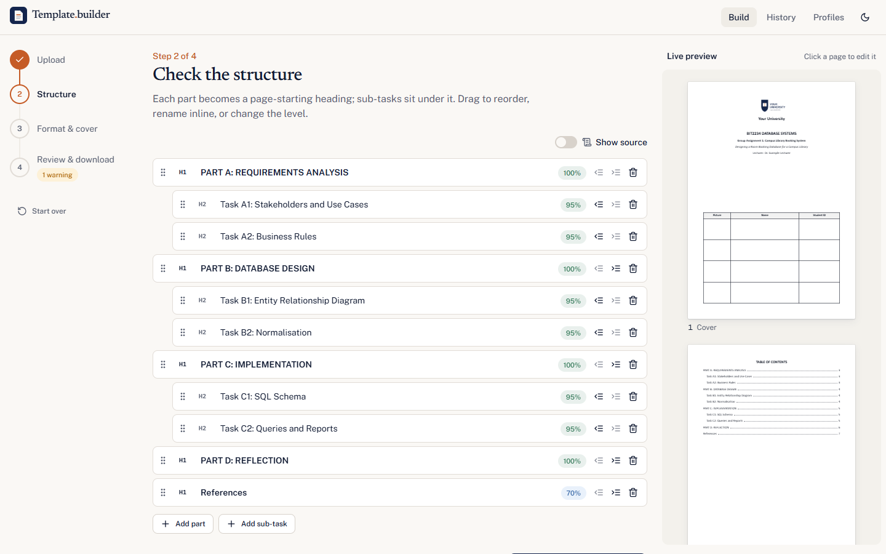
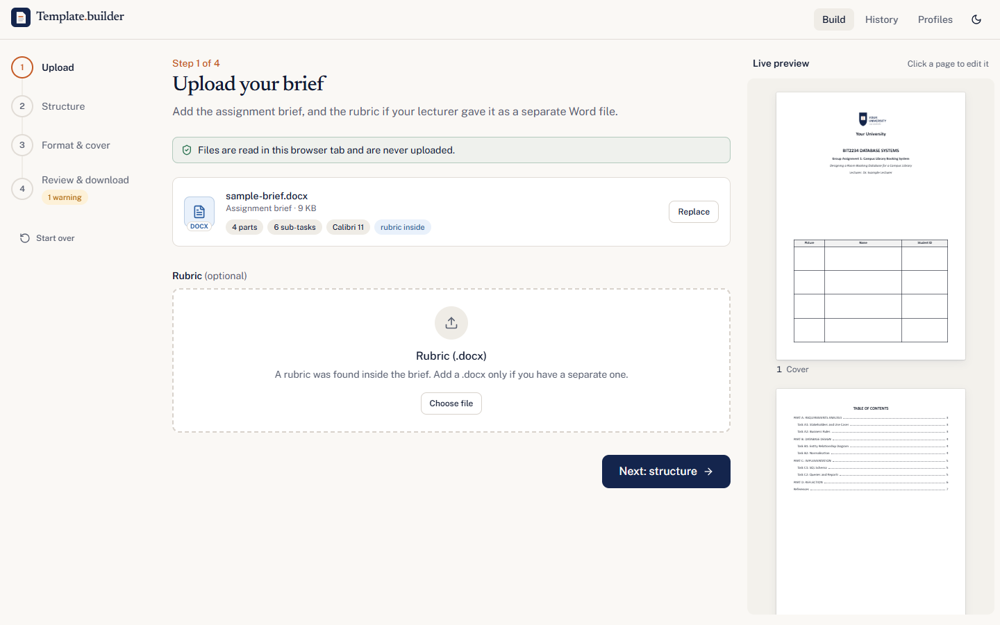
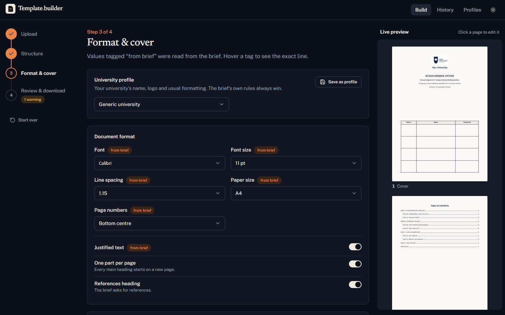
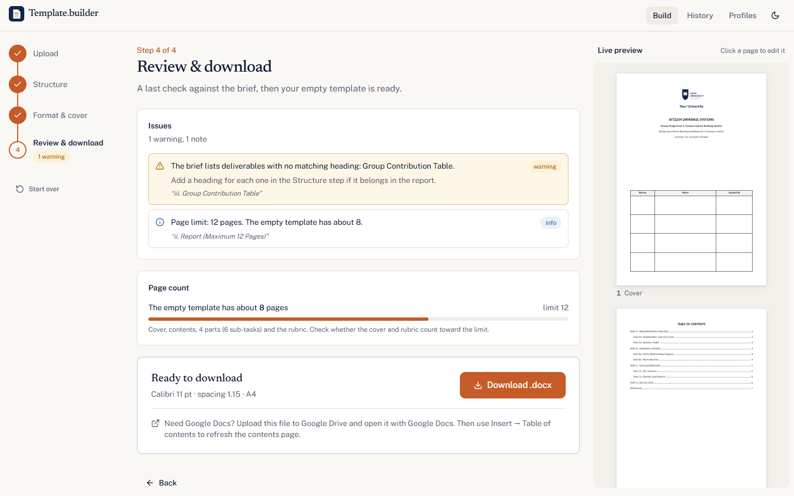

# Report Template Builder

Turn any assignment brief into a ready-to-fill Word (.docx) report template.

Upload the brief (and the rubric, if you have it) and get an **empty**, correctly formatted report: cover page, table of contents, every part on its own page, and the rubric at the end – in the font, size and spacing the brief asks for. The app never writes report content. It only builds the structure.



> **Private by design.** Everything runs in your browser. There is no server: briefs, rubrics and logos are never uploaded anywhere.

## Features

- **Reads .docx and .pdf briefs**, including PDFs whose text is split into fragments, and briefs with a 2-column "No. | Question" table. Scanned PDFs get a friendly message and a "paste the text" fallback.
- **Finds the structure**: `PART A: …`, `Part 1 – …`, `SECTION 2: …` become Heading 1; `Task B1: …`, `Activity 3: …` become Heading 2 under their part; numbered questions become parts; References is added when the brief asks for it. Every heading has a confidence score, and low-confidence ones are flagged for review.
- **Reads the formatting rules**: font, size, line spacing, justification, paper size, page-number position, cover colour ("cover page's color is LIGHT BLUE"), page limit and due date – each shown with the line of the brief it came from.
- **Builds the .docx** in this order:
  1. Cover page (no page number) – the brief's own cover sheet rebuilt from its fields, or a generated one with logo, university, subject, title, lecturer and a Picture | Name | Student ID table. Optional full-page cover colour.
  2. A real Word table of contents (Heading 1–2), pre-filled, and refreshed by Word on open.
  3. One page per part, headings only.
  4. The rubric as the final section: a rubric .docx is merged in **unchanged** (landscape pages, fonts, theme, tables, images, numbering); a rubric inside a PDF or .docx brief is rebuilt as a Word table.
- **Catches gotchas**: a cover sheet saying "individual" on a group brief, a past due date, a missing coloured cover, too many pages for the limit, deliverables with no matching heading.
- **Live A4 preview** of every page; click a page to jump to its settings.
- **History** of templates you built (settings only) and **university profiles** (logo, name, default formatting).
- Light and dark mode, keyboard accessible, respects reduced motion, works on phones.

| Upload | Format & cover | Review |
| --- | --- | --- |
|  |  |  |

## Run it locally

Requires Node.js 20 or newer.

```bash
npm install
npm run dev          # http://localhost:5173
```

| Command | What it does |
| --- | --- |
| `npm run dev` | Development server |
| `npm run build` | Production build into `dist/` |
| `npm run preview` | Serve the production build |
| `npm test` | Unit tests (Vitest) |
| `npm run test:e2e` | End-to-end tests (Playwright). On Windows they use the built-in Microsoft Edge; elsewhere run `npx playwright install chromium` once first |
| `npm run validate:docx` | Build templates from every brief in `fixtures/` and check them (XML, structure, and page order via LibreOffice or Microsoft Word + pdftotext) |
| `npm run lint` / `npm run typecheck` | ESLint / TypeScript |

### Testing with your own briefs

Put real briefs and rubrics in `fixtures/` (for example `A2.docx` and `RUBRIC_A2.docx`; a rubric is paired with the brief whose name it contains). The folder is **git-ignored**, so your assignment files are never committed. Unit tests, `validate:docx` and the e2e tests pick them up automatically; without them, the tests use the bundled fictional sample in `public/samples/`.

## Deploy to GitHub Pages

1. Push the repository to GitHub (branch `main`).
2. In the repository, open **Settings → Pages** and set **Source** to **GitHub Actions**.
3. Every push to `main` runs `.github/workflows/deploy.yml`: install → lint → type check → unit tests → build → deploy. The site appears at `https://<username>.github.io/<repo>/`.

The base path is set from the repository name automatically (`BASE_PATH`), and the app uses hash routes (`/#/build`), so refreshing any page works on Pages. Pull requests run `.github/workflows/ci.yml` (lint, types, unit tests, build and Playwright).

## Add a university profile

**In the app:** open **Profiles → New profile**, or in step 3 click **Save as profile**. Profiles hold the university name, logo, default font/size/spacing/page numbers and cover layout, and are saved in your browser. A brief's own rules always win over a profile.

**Shipped with the app** (for everyone who opens your deployment): edit `DEFAULT_PRESET` in [`src/store/presets.ts`](src/store/presets.ts). For a logo, export a PNG and add it like `src/assets/placeholderLogo.ts` does (a data URL plus its pixel size). Only ship a logo you are allowed to use.

## How it works

```
src/lib/extract    .docx (JSZip) and .pdf (pdf.js) → ordered lines with bold/table/page info
src/lib/detect     headings, format rules, cover fields, rubric pages/table, issues
src/lib/generate   docx library → template; then TOC cache, rubric XML merge, clean zip
src/workers        parsing runs in a Web Worker so the UI stays smooth
src/components     shadcn/ui-style components, builder steps, live preview
scripts            validate-docx, PDF rendering, asset generators
e2e                Playwright tests (upload → download → page-order checks, privacy)
```

Tech: Vite, React, TypeScript (strict), Tailwind CSS, Radix/shadcn-style components, Framer Motion, dnd-kit, Zustand, `docx`, JSZip, pdf.js, Vitest, Playwright.

## Known limitations

- **Heading detection is rule-based.** Unusual briefs may need headings added or fixed in the Structure step. If a brief is misread, add it to `fixtures/` with the expected headings and adjust the rules in `src/lib/detect/headings.ts`.
- **Scanned PDFs** have no text to read; paste the text instead (or run OCR first).
- **Rubrics inside a PDF** are rebuilt from text positions. Merged cells and unusual layouts may need checking; a rubric .docx is always copied exactly.
- **Table of contents:** Word asks to update fields on open – choose Yes. **Google Docs** ignores Word TOC fields: after opening the file in Google Docs, use *Insert → Table of contents*.
- **Fonts** must be installed on the computer that opens the file; otherwise Word substitutes a similar one.
- History and profiles live in this browser's storage. Clearing site data removes them; uploaded files are never stored.

## License

[MIT](LICENSE)
